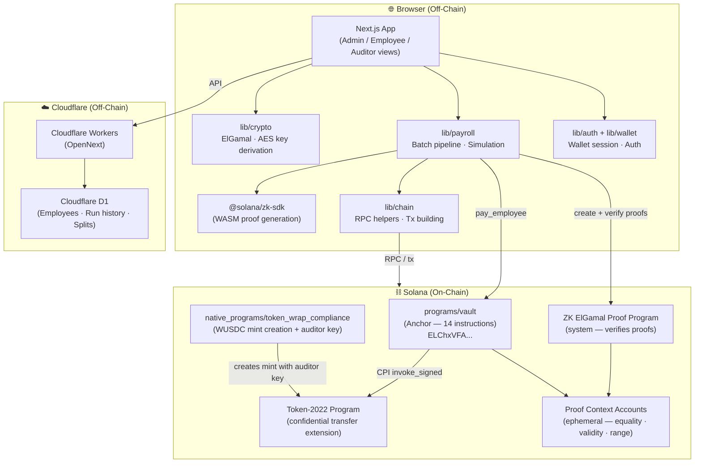
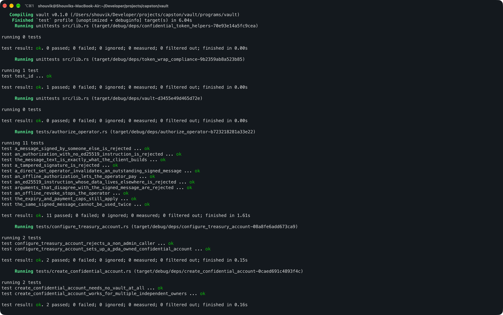
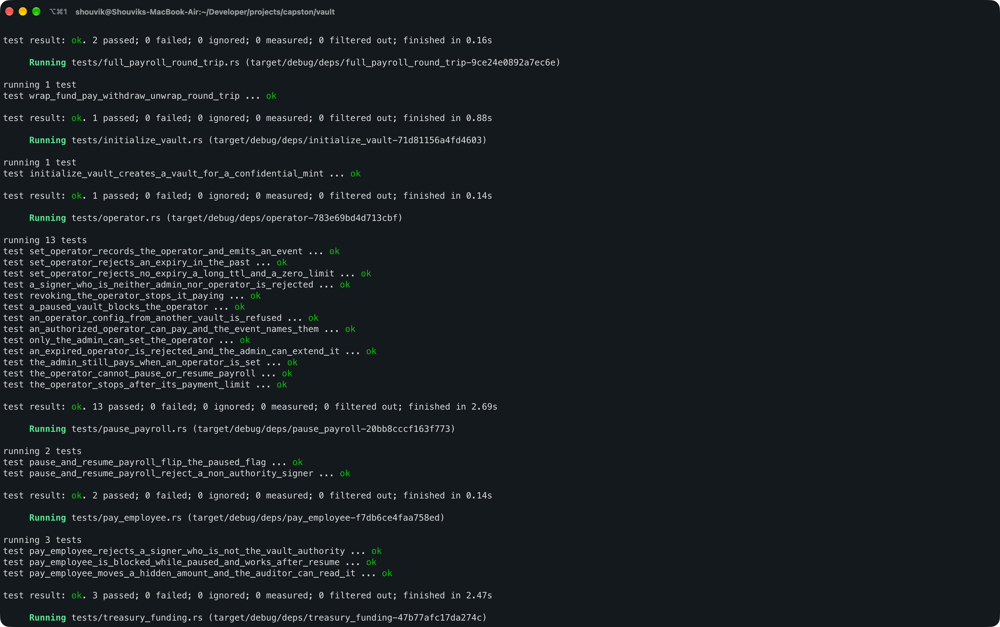
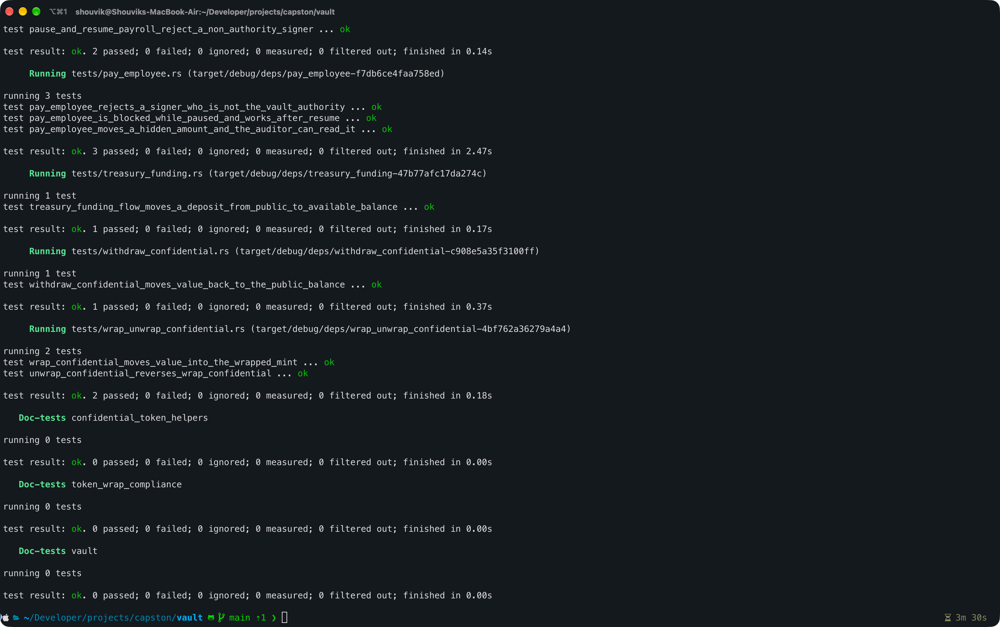

# 🔐 CipherPay — Confidential Payroll on Solana

> **"Payroll where the public can't see salaries, but the auditor can."**

CipherPay is a confidential payroll protocol built on Solana that uses **Token-2022's Confidential Transfer extension** to encrypt salary amounts end-to-end. An employer funds a treasury with USDC, approves a payroll run, and every employee is paid in a single batched flow. Amounts are encrypted on-chain — the public sees _that_ payroll happened, never _how much_.

Built for the **Colosseum Solana Hackathon** (devnet only).

---

## ✨ Key Features

- 🔒 **Amount privacy** — salary amounts are ZK-encrypted on-chain via Token-2022 Confidential Transfer
- 🏛️ **Compliance-first** — a designated auditor can decrypt all payments; mixer-style unlinkability is deliberately out of scope
- ⚡ **Batch payroll** — pay an entire team in one UI flow (client-orchestrated, proof-chunked pipeline)
- 🔁 **Split payouts** — rule-based splits (e.g. 79% employee / 20% tax reserve / 1% platform fee) for contractor payments
- 🛡️ **Simulation before execution** — balance checks, recipient activation checks, and totals before anything moves
- ⏸️ **Pause / resume** — admin can halt new payouts without freezing employee withdrawals
- 🔑 **Operator key** — admin authorizes a scoped operator key so a full payroll run doesn't require a wallet popup per transaction
- 📋 **Auditor view** — auditor decrypts all payment ciphertexts emitted in on-chain events, no chain indexer needed

---

## 🏗️ Architecture Overview

CipherPay is split into two independent but tightly coupled halves: an **on-chain half** (Rust / Anchor programs deployed to Solana) and an **off-chain half** (Next.js app that runs ZK proof generation in the browser). Neither half can do payroll alone.

### Repository Layout

```
vault/                                        ← Anchor workspace root
├── programs/
│   └── vault/                                ← Anchor program (14 instructions)
│       └── tests/                            ← litesvm in-process tests
├── native_programs/
│   └── token_wrap_compliance/                ← Raw native program (fork of Anza spl-token-wrap)
│       └── DEVNET_DEMO_AUDITOR_KEY.md        ← Auditor keypair reference
├── libs/
│   └── confidential_token_helpers/           ← Shared Rust library (not deployed)
├── client/                                   ← Standalone TS round-trip client (reference / testing)
│   └── src/roundTrip.ts
└── web/                                      ← Next.js 16 app — product UI + proof orchestration
    ├── src/
    │   ├── app/                              ← Next.js App Router pages
    │   └── lib/                              ← Crypto, chain, payroll, wallet, auth modules
    └── CLAUDE.md                             ← Web-half engineering conventions
```

### Component Diagram



### Two-Halves Design

| Half | What it does |
| --- | --- |
| **On-chain** (`programs/`, `native_programs/`) | Anchor instructions, ZK proof verification, vault state, payroll guards |
| **Off-chain** (`web/`) | Proof generation (WASM), batch pipeline orchestration, employee list, run history, Next.js UI |

> ⚠️ A change to any instruction, account, event, or error in the on-chain half is a **breaking change** for `web/` until the IDL and generated client are regenerated (`bun run gen:vault`).

---

## 🔑 Core Design Decisions

### 1 · Spend Authority vs. Decryption Authority

These two identities are **intentionally separate** and must never be conflated:

| Identity | Holder | What it controls |
| --- | --- | --- |
| **Spend authority** | Vault PDA | Calls confidential `Transfer` via `invoke_signed` |
| **Decryption authority** | Admin's derived ElGamal / AES keys | Reads encrypted treasury balances |

The PDA **cannot** decrypt. Only the admin (and the auditor) can read treasury amounts. This means a compromised server that holds the PDA seeds cannot drain funds in plaintext.

### 2 · Key Derivation (Deterministic, In-Memory)

Keys are **never randomly generated and stored**. They are re-derived each session from the wallet:

```
ElGamalKeypair = derive(Ed25519_sign(fixed_message, owner_pubkey, mint_pubkey))
AeKey          = derive(Ed25519_sign(fixed_message, owner_pubkey, mint_pubkey))
```

Ed25519 signatures are deterministic, so this is fully reproducible from the wallet alone — no key backup, no server storage. Keys live **in browser memory only** and are cleared on disconnect. Implemented via `deriveElGamalKeypairForOwnerMint` / `deriveAeKeyForOwnerMint` from `@solana-program/token-2022/confidential`.

> Hardware wallets that do not support `signMessage` cannot use the app.

### 3 · ZK Proofs Are Always Client-Side

A confidential `Transfer` requires **three ZK proofs**:

| Proof | Proves |
| --- | --- |
| **Equality** | The same amount is committed in sender and receiver ciphertexts |
| **Ciphertext-validity** | Each ciphertext is well-formed under the recipient's key |
| **Range** | The transferred amount is non-negative and does not overdraft |

These proofs do not fit alongside the transfer instruction in a single transaction (Solana's **1,232-byte wire limit**). The solution — two transactions per proof before the transfer:

```
┌─ Tx 1 ──────────────────────────────────┐
│  create_account (context-state PDA)     │
│  VerifyProof → write proof into account │
└─────────────────────────────────────────┘
         ↓  (repeated for all 3 proofs)
┌─ Tx 2 ──────────────────────────────────┐
│  pay_employee                           │
│  → reads + closes context accounts      │
└─────────────────────────────────────────┘
```

The batch pipeline orchestrates this **chunked, parallelizable** flow per recipient. `litesvm` does **not** enforce the 1,232-byte limit — always test proof context flows against a real validator (surfpool / devnet).

### 4 · Compliance Model (Auditor-Encrypted Dual Ciphertext)

Every confidential transfer is **dual-encrypted**: once for the recipient and once for the **auditor's ElGamal pubkey**, which is baked into the WUSDC mint at creation time by `token_wrap_compliance`.

```
pay_employee tx
  ├── recipient ciphertext  (only recipient can decrypt)
  └── auditor ciphertext    (only auditor can decrypt — emitted in event)
```

- `Withdraw` and `Unwrap` make a specific amount plaintext — **partial disclosure is supported**
- There is **no anti-correlation infrastructure** — no jitter, batching-as-obfuscation, or mixing. This is a deliberate design choice to avoid the shielded-pool / Tornado Cash legal exposure

### 5 · Batch Pipeline & Operator Key

Paying N employees means N × (3 proof tx pairs + 1 pay_employee tx). To avoid a wallet popup per transaction and to fit within devnet's ~40s transaction window, the admin can authorize a **scoped operator key**:

- Registered via `set_operator` — stored in its own PDA so existing vaults are unaffected
- Operator may sign **only `pay_employee`**, with an optional expiry and revocation
- Exposure is bounded by expiry; the program cannot cap amounts (amounts are encrypted)

### 6 · Off-Chain Data Model

Employee data, payroll runs, and split-payout rules live **off-chain** in Cloudflare D1 (SQLite via Drizzle ORM). Nothing salary-related is stored on-chain in plaintext.

| Store | Contents |
| --- | --- |
| **On-chain** | Vault PDA state, confidential token account balances (encrypted), proof context accounts (ephemeral) |
| **Off-chain (D1)** | Employee list (name, wallet, salary), payroll run history, tx signatures per recipient, split-payout rules |

---

## 📦 On-Chain Programs

### `vault` (Anchor)

Program ID (devnet): `ELChxVFAiE5jv1SV3v3gprWeWxmbgX7ATWingW5VcB48`

The core payroll vault program. All 14 instructions are implemented and tested on litesvm + local surfpool.

| Instruction                   | Description                                                          |
| ----------------------------- | -------------------------------------------------------------------- |
| `initialize_vault`            | Create a new payroll vault PDA                                       |
| `configure_treasury_account`  | Set up the vault's confidential treasury token account               |
| `fund_treasury`               | Transfer WUSDC into the treasury                                     |
| `deposit_confidential`        | Deposit plaintext balance into the confidential balance              |
| `apply_treasury_pending`      | Apply pending confidential balance for the treasury                  |
| `pay_employee`                | Transfer encrypted funds from treasury to one employee (3 ZK proofs) |
| `pause_payroll`               | Halt `pay_employee` (withdrawals remain open)                        |
| `resume_payroll`              | Re-enable `pay_employee`                                             |
| `set_operator`                | Register a scoped operator key (optional expiry)                     |
| `authorize_operator`          | Operator delegation for signing pay_employee                         |
| `create_confidential_account` | Set up a wallet-owned confidential token account                     |
| `wrap_confidential`           | 1:1 wrap real USDC → WUSDC (confidential-capable)                    |
| `withdraw_confidential`       | Employee withdraws encrypted pay (2 ZK proofs)                       |
| `unwrap_confidential`         | Unwrap WUSDC → real USDC                                             |

### `token_wrap_compliance` (Native)

A fork of Anza's `spl-token-wrap`. Creates the canonical **WUSDC mint** with:

- Confidential Transfer extension
- Designated auditor key
- Permanent delegate
- Pausable

---

## 🌐 Web Application (`web/`)

A **Next.js 16** app (App Router) deployed to Cloudflare Workers via OpenNext.

### Tech Stack

| Layer           | Choice                                            |
| --------------- | ------------------------------------------------- |
| Framework       | Next.js 16 (App Router), React 19, TypeScript     |
| Package Manager | Bun 1.3.14                                        |
| Styling         | Tailwind CSS v4, shadcn/ui                        |
| Solana Client   | `@solana/kit` v8, `@solana-program/token-2022`    |
| ZK Proofs       | `@solana/zk-sdk` (WASM, browser), `@noble/curves` |
| Database        | Cloudflare D1 (SQLite) via Drizzle ORM            |
| Deployment      | Cloudflare Workers (OpenNext)                     |

### App Routes

| Route      | View                                           | Who uses it    |
| ---------- | ---------------------------------------------- | -------------- |
| `/`        | Landing / home                                 | Everyone       |
| `/app`     | Dashboard overview                             | Admin          |
| `/admin`   | Payroll management, employee list, vault setup | Employer admin |
| `/pay`     | Execute a payroll run, approve payouts         | Employer admin |
| `/auditor` | Decrypt and verify all payment ciphertexts     | Auditor        |

### Library Modules (`web/src/lib/`)

| Module     | Description                                                      |
| ---------- | ---------------------------------------------------------------- |
| `crypto/`  | ElGamal / AES key derivation, encryption, decryption             |
| `chain/`   | Solana RPC helpers, transaction building, proof context accounts |
| `payroll/` | Batch pipeline orchestration, simulation, run tracking           |
| `wallet/`  | Wallet connection and session key management                     |
| `auth/`    | Authentication helpers                                           |
| `mock/`    | Stub implementations for offline / UI development                |

---

## 🚀 Getting Started

### Prerequisites

- [Rust](https://www.rust-lang.org/tools/install) + `cargo`
- [Solana CLI](https://docs.solana.com/cli/install-solana-cli-tools) ≥ 1.18
- [Anchor CLI](https://www.anchor-lang.com/docs/installation) ≥ 0.30
- [Bun](https://bun.sh) ≥ 1.3.14
- [Surfpool](https://surfpool.run) (for local validator testing)
- `spl-token-cli` **≥ 5.6.1** (install with `--locked`)

### 1. Clone & Install

```bash
git clone <repo-url>
cd vault
```

### 2. Build the On-Chain Programs

> ⚠️ Build with `--arch v1` — the current surfpool version requires the older SBPF target. A default-arch deploy fails with `ELF error: Detected sbpf_version required by the executable which are not enabled`.

```bash
cargo build-sbf --arch v1 --manifest-path programs/vault/Cargo.toml
cargo build-sbf --arch v1 --manifest-path native_programs/token_wrap_compliance/Cargo.toml
```

### 3. Run Tests

```bash
# Runs cargo build-sbf --arch v1 then cargo test (litesvm + integration)
anchor test
```

### 4. Deploy to Local Surfpool

```bash
# Start local validator (offline mode)
surfpool start --offline --no-deploy --no-tui --no-studio &

# Point CLI at local validator
solana config set --url http://127.0.0.1:8899

# Deploy both programs
solana program deploy target/deploy/vault.so \
  --program-id target/deploy/vault-keypair.json

solana program deploy target/deploy/token_wrap_compliance.so \
  --program-id target/deploy/token_wrap_compliance-keypair.json
```

> Remember to switch back: `solana config set --url <cluster>` before doing anything against devnet/mainnet.

### 5. Run the TS Round-Trip Client

The `client/` directory contains a standalone TypeScript script that proves the entire payroll flow end-to-end against a real validator.

```bash
cd client
npm install

# Against local surfpool
npm run round-trip:surfpool

# Against Solana devnet (needs ~0.65 SOL in FUNDER_KEYPAIR = ~/.config/solana/id.json)
npm run round-trip:devnet
```

The script logs each step with addresses and amounts, and exits non-zero if any balance check fails.

### 6. Run the Web App

```bash
cd web
bun install

# Copy environment config
cp .env.example .env.local
# Edit .env.local — set NEXT_PUBLIC_SOLANA_RPC_URL to a dedicated devnet endpoint

# Apply local DB migrations
bun run db:migrate:local

# Start dev server
bun run dev
```

Open [http://localhost:3000](http://localhost:3000).

---

## ⚙️ Environment Variables

### `web/.env.local`

| Variable                     | Description                           | Default                         |
| ---------------------------- | ------------------------------------- | ------------------------------- |
| `NEXT_PUBLIC_SOLANA_RPC_URL` | Solana RPC endpoint (browser-visible) | `https://api.devnet.solana.com` |

> The public devnet RPC rate-limits the batch payout pipeline. Use a dedicated endpoint (e.g., Helius, Triton) for payroll runs.

### `web/.dev.vars` (Cloudflare / Wrangler)

Used for local Cloudflare Workers secrets. Copy from `.dev.vars.example` and fill in values before running `bun run preview`.

---

## 🗄️ Database

The app uses **Cloudflare D1** (SQLite-compatible) via **Drizzle ORM** for off-chain data:

- Employee list (name, wallet address, salary)
- Payroll run history (status, tx signatures per recipient)
- Split payout rules and approvals

```bash
# Generate migrations after schema changes
bun run db:generate

# Apply to local D1
bun run db:migrate:local

# Apply to remote D1 (Cloudflare)
bun run db:migrate:remote

# Open a SQL shell (local)
bun run db:shell:local "SELECT * FROM employees"

# Reset local DB
bun run db:reset:local
```

---

## 🧪 Testing

| Test suite                     | Location                  | Command                       |
| ------------------------------ | ------------------------- | ----------------------------- |
| On-chain (litesvm, in-process) | `programs/vault/tests/`   | `anchor test`                 |
| Round-trip (surfpool / devnet) | `client/src/roundTrip.ts` | `npm run round-trip:surfpool` |
| Web unit tests                 | `web/`                    | `bun test`                    |

> **Important:** litesvm does not enforce Solana's 1232-byte transaction limit. Real-validator tests (surfpool / devnet) are required to validate the two-transaction proof context flow.

### 📸 Test Screenshots

<p align="center">
  
  <br/><br/>
  
  <br/><br/>
  
</p>

---

## 📋 On-Chain Payroll Flow

```
Admin                  App (Browser)               Solana Chain
  │                        │                            │
  ├─ Connect wallet ──────►│                            │
  │                        ├─ derive ElGamal/AES keys   │
  │                        │   (signMessage, in-memory) │
  │                        │                            │
  ├─ Fund treasury ───────►│                            │
  │                        ├─ wrap USDC → WUSDC ───────►│ token_wrap_compliance
  │                        ├─ fund_treasury ────────────►│ vault
  │                        ├─ deposit_confidential ─────►│ vault
  │                        ├─ apply_treasury_pending ───►│ vault
  │                        │                            │
  ├─ Approve payroll ─────►│                            │
  │                        ├─ Simulate (balance check, recipients activated)
  │                        │                            │
  │                        │  Per employee:             │
  │                        ├─ create equality ctx ──────►│ ZK ElGamal Proof Program
  │                        ├─ verify equality proof ────►│
  │                        ├─ create validity ctx ──────►│
  │                        ├─ verify validity proof ────►│
  │                        ├─ create range ctx ─────────►│
  │                        ├─ verify range proof ───────►│
  │                        ├─ pay_employee ─────────────►│ vault (emits auditor ciphertext event)
  │                        │                            │
Employee                   │                            │
  ├─ withdraw ────────────►│                            │
  │                        ├─ withdraw_confidential ────►│ vault
  │                        ├─ unwrap_confidential ──────►│ vault
  │◄─ USDC in wallet ──────│                            │
```

---

## 🏛️ Auditor Flow

1. `pay_employee` emits an event containing the payment amount **encrypted for the auditor** (ciphertext taken from the proof context account — guaranteed to match what was proven on-chain)
2. The client stores the transaction signature per recipient in the off-chain run history
3. The auditor opens the `/auditor` view, fetches each transaction by signature, and decrypts the ciphertext with their secret key
4. Decrypted amounts → verified, tamper-evident payment record

> The auditor key is currently a **platform-wide key** on the canonical WUSDC mint. Per-employer auditors are a Phase 2 feature.

---

## 🗺️ Roadmap

| Phase       | Description                                                                                                                | Status      |
| ----------- | -------------------------------------------------------------------------------------------------------------------------- | ----------- |
| **Phase 0** | Token-2022 primitives, `token_wrap_compliance`, all 14 vault instructions, litesvm + surfpool tests                        | ✅ Complete |
| **Phase 1** | Next.js app on devnet, batch pipeline, admin/employee/auditor views, simulation, split payouts                             | ✅ Complete |
| **Phase 2** | TypeScript SDK (custody-safe, customer-held keys), hosted API (simulation, webhooks, reconciliation), per-employer auditor | 📋 Planned  |
| **Phase 3** | Recurring / milestone / event-triggered payments, multi-party approvals, spending limits                                   | 📋 Planned  |
| **Phase 4** | Mainnet deployment, authority role hardening, security review, real auditor key management                                 | 📋 Planned  |

---

## 🔒 Security Model

| Property                                  | How it's achieved                                                                       |
| ----------------------------------------- | --------------------------------------------------------------------------------------- |
| **Salary amounts hidden from public**     | Token-2022 Confidential Transfer — amounts are ElGamal-encrypted on-chain               |
| **Auditor can always verify**             | Every transfer is dual-encrypted (recipient + auditor pubkey) at the program level      |
| **Treasury keys never leave the browser** | Keys derived from `signMessage` → in-memory only → cleared on disconnect                |
| **No server custody**                     | All ZK proof generation runs in the browser (WASM). Our servers never hold private keys |
| **Spend authority ≠ decrypt authority**   | Vault PDA controls spending; admin's derived keys control decryption                    |
| **Operator key is scoped**                | `set_operator` allows signing only `pay_employee`, with optional expiry and revocation  |

### Known Limitations (Hackathon Build)

- Devnet only — **not audited for mainnet**
- All four WUSDC mint authority roles point to one deployer wallet (split before real funds)
- Auditor key is platform-wide on the canonical WUSDC mint (per-employer auditors are Phase 2)
- Employees need their own SOL for withdrawal fees (fee sponsorship is roadmap)

---

## 📁 Key Files Reference

| File                                     | Purpose                                                |
| ---------------------------------------- | ------------------------------------------------------ |
| [`PRODUCT.md`](./PRODUCT.md)             | Product context, decisions log, architecture deep-dive |
| [`CLAUDE.md`](./CLAUDE.md)               | On-chain half engineering conventions                  |
| [`web/CLAUDE.md`](./web/CLAUDE.md)       | Web half engineering conventions                       |
| [`web/DESIGN.md`](./web/DESIGN.md)       | UI/UX design system and component guidelines           |
| [`Anchor.toml`](./Anchor.toml)           | Anchor workspace config and program IDs                |
| [`client/README.md`](./client/README.md) | Round-trip TS client usage guide                       |

---

## 🛠️ Useful Scripts

```bash
# Regenerate Anchor IDL and vault TypeScript client
cd web && bun run gen:vault

# Typecheck the web app
cd web && bun run typecheck

# Generate Cloudflare env types
cd web && bun run cf-typegen

# Deploy to Cloudflare Workers
cd web && bun run deploy

# Preview locally with Cloudflare runtime
cd web && bun run preview
```

---

## 📜 License

This project was built for the Colosseum Solana Hackathon. License TBD.

---

<div align="center">
  <strong>Built with ❤️ on Solana</strong><br/>
  <sub>Token-2022 Confidential Transfer · ZK ElGamal Proofs · Anchor · Next.js · Cloudflare Workers</sub>
</div>
